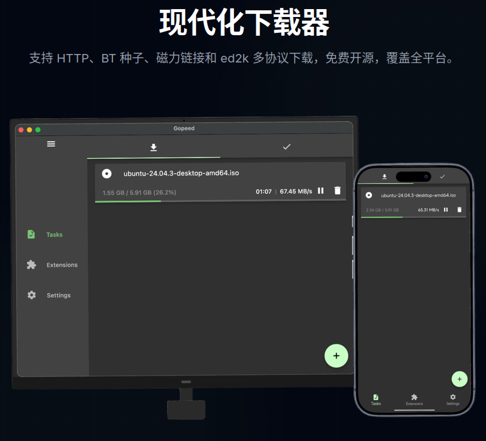
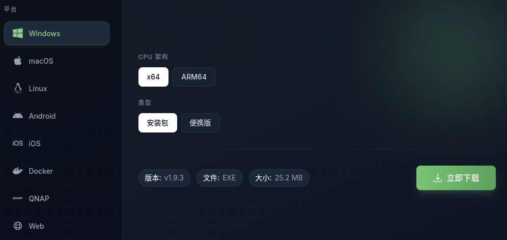
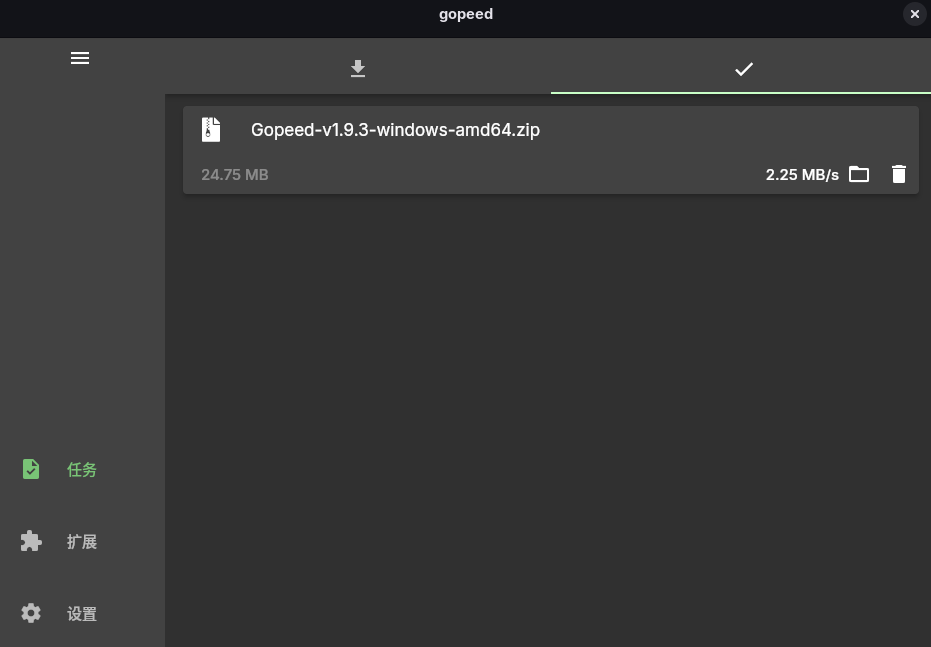
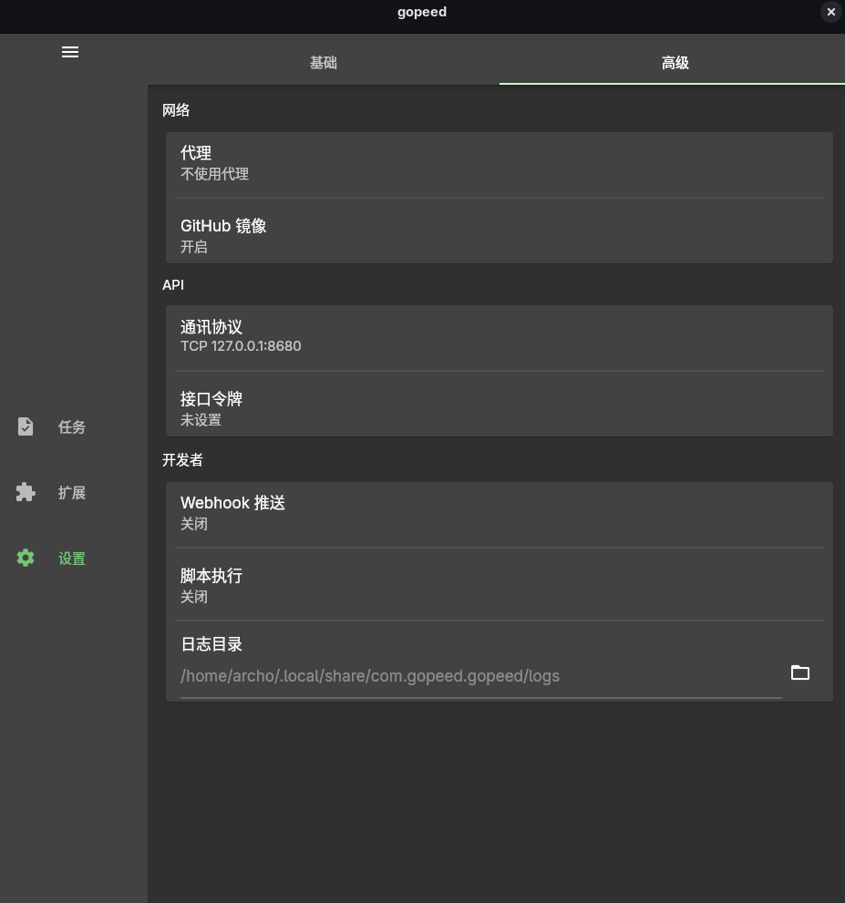
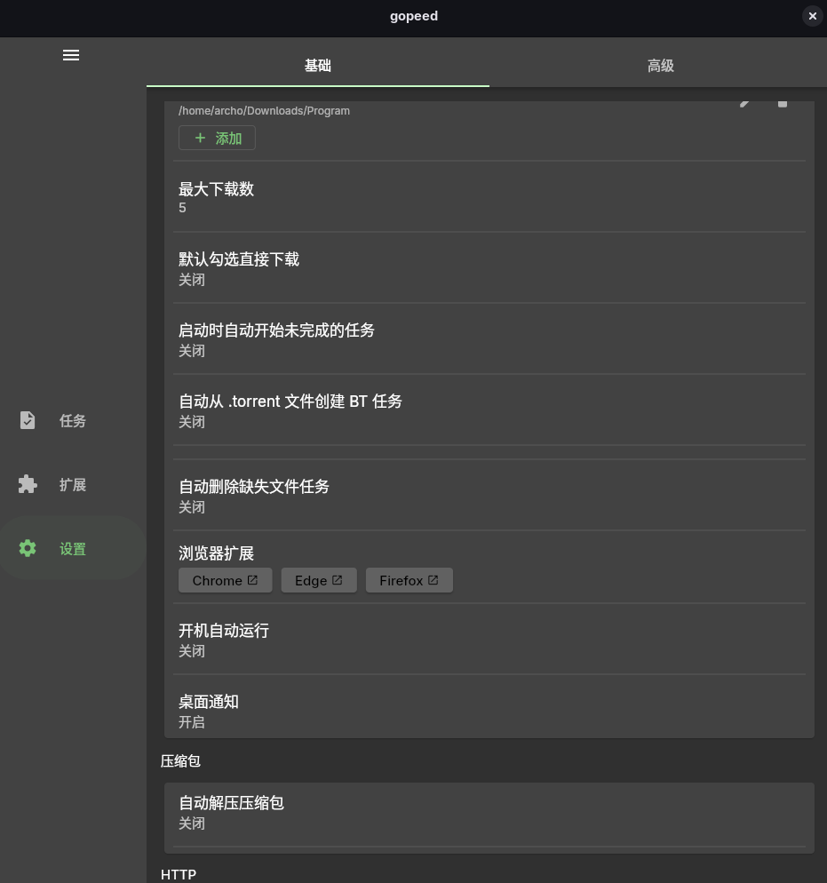
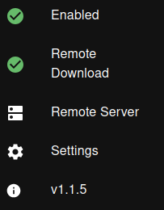
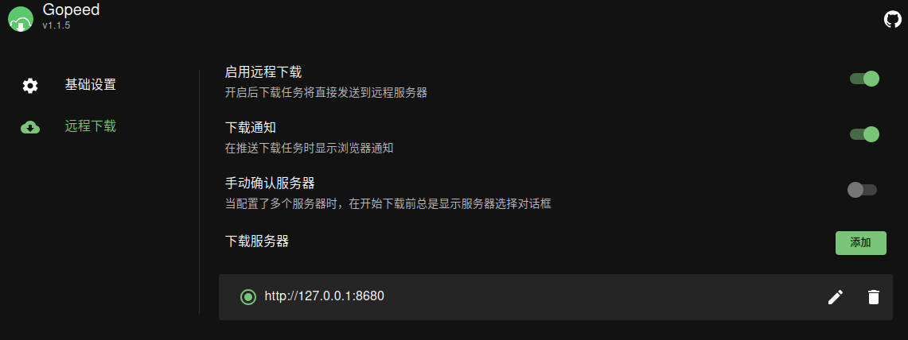
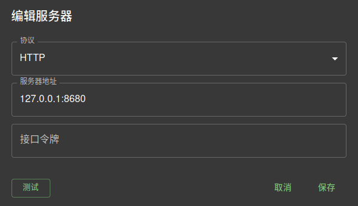

# 下载器折腾，IDM的替代品——Gopeed

<!-- 把图片放进这个文件夹（essays/2026-10-16/），然后在正文里这样引用：
     
     正文的第一张图会自动成为首页封面。 -->



## 前言

在以前我还在整windows下载的时候，就听说过IDM(Internet Download Manager)鼎鼎大名，多线程拉满下载速度这一块，但当我自己上手就发现需要什么付费正版购买之类的。
那会还是学生没有这个钱就变成自己整了个超级破解版，但实际上使用体验也说不上太好，下载速度确实没的说，但每次开机开软件都给我提示一句购买正版的弹窗烦得很。
所以后来开始找IDM的替代品，找到了FDM（Free Download Manager），但FDM又在UBUNTU上面连接不上Firefox，总之辗转最后来到了Gopeed，同样跨平台，但更加支持插件，对应的折腾也多些。不过我目前的移动硬盘linux系统大概很长时间也不会换，就算迁移机器也不需要换，所以这一次折腾还是挺有价值的。

## 谈谈我为什么使用它

- 首先他开源，源代码公开给用户审查，可以说一开始就给了第三方介入，于我而言就像是法庭上的公民陪审团，或许“作用”不大，但有和没有是两回事
- 界面现代，整体风格上和现代系统WIN11、特化个人桌面美化的Linux更加harmony(和谐)，而FDM更像是WIN10磁贴风的搭配(所以我仍然在我的windows上面使用FDM)
- 能装很多插件，可拓展性不错，插件第一的是接管百度云盘下载
- 跨平台兼容
- 都用Linux了，搞点折腾，支持脚本
- 我把Linux装在移动硬盘，个人桌面系统带着走随便插，重复折腾的可能性低。


## 下载&安装这一块

你可以先去[中文官网](https://gopeed.com/zh)走一趟，直接下载



或者是到[GitHub仓库](https://github.com/GopeedLab/gopeed/releases/tag/v1.9.3)看看那些包
> github的release页面有很多个可下载的选项，小白不知道可以截图问ai，系统和使用场景告诉他




## 折腾配置

下载安装完成后我们打开他，进入主页面，点到**设置**页面里面，然后点击其中的**高级**，然后点击API，将通讯协议改为TCP，并填写好IP和端口，可参照下图。



因为要替代IDM，所以肯定要让Gopedd接管浏览器的下载，这需要浏览器安装扩展插件，并且在Gopeed中设置一个服务端与我们刚才设置的服务端相连。所以点到软件中的**设置-基础**，并在里面选择自己浏览器对应的扩展安装。



接着打开刚安装好的浏览器扩展，应该会显示在浏览器右上角位置，并点击扩展页面中的**setting(设置)**。



在设置中，点击**远程下载**，按照我下图的设置来配置，启用远程下载、下载通知，并添加一个下载服务器。



其中下载服务器中最后有一个**四位数数字**，这四位数数字你随便捏一个1919都行，只要不和你目前开的服务重合就没有问题。
当然你可以先查看一下目前电脑哪些端口被占用了：

- Linux终端

     ```bash
     sudo ss -tulnp
- Windows，win+r，输入cmd进入终端后输入

     ```cmd
     netstat -ano | findstr LISTENING

在浏览器扩展中设置好服务器后，你可以点击**测试**，测试服务器没问题就可以接管下载了。



[测试下载-gopeed便携版](https://github.com/GopeedLab/gopeed/releases/download/v1.9.3/Gopeed-v1.9.3-windows-amd64-portable.zip)
